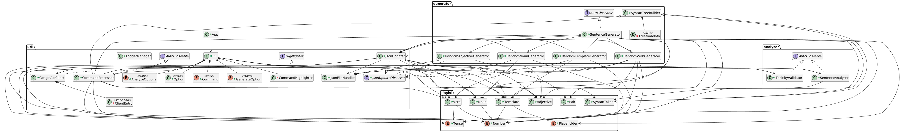

<h1 align="center">NonSense Generator</h1>

<p align="center">
  A Java command-line app that <b>generates</b> grammatically correct but meaningless sentences
  and <b>analyzes</b> them with the <b>Google Cloud Natural Language API</b>.
</p>

<p align="center">
  
  
  
  
</p>

Team project for the course **Software Engineering** (University of Padua, 2024–2025).

---

## Overview

NonSense Generator picks random **nouns, verbs and adjectives** from its dictionaries and
places them into random **sentence templates**. The result is always grammatically correct,
but has no logical meaning, for example:

```text
The spare fruits balance near the things.
```

Any sentence, generated or typed by the user, can then be sent to the Google Cloud Natural
Language API to study its **syntax**, **sentiment**, **entities** and **toxicity**, and to
print its **syntax tree**.

## Features

- **Random sentence generation** from templates, with agreement of number and verb tense.
- **Sentence analysis** through Google Cloud Natural Language:
  - syntax: part of speech of every word
  - sentiment
  - entities
  - toxicity, with a tolerance threshold you can change (default 0.7)
- **Syntax tree** of one or more sentences, printed in the terminal.
- **Dictionary extension**: add your own nouns, verbs and adjectives at runtime.
- **Guided modes**: `default` runs a complete generate → analyze → tree flow, while
  `personalized` lets you choose every option at each step.
- **Interactive CLI** with command shortcuts, help, detailed info and a hidden verbose mode.
- **Logging** with Log4j 2 into a `logs/` folder.

---

## Getting started

### Requirements

- **JDK 21** or newer
- **Apache Maven 3.9** or newer
- A **Google Cloud** project with the Natural Language API enabled, and a service account key
- An internet connection

### Google Cloud credentials

1. Create a service account key (JSON) in your Google Cloud project.
2. Rename it to **`credentials.json`**.
3. Put it in the `config/` folder.

The file is listed in `.gitignore`, so it is never committed.

### Build and run

```bash
git clone https://github.com/sclosaf/NonSense-Generator.git
cd NonSense-Generator/scripts

./mvn.sh all        # clean, compile, test, generate docs and run
```

Or step by step:

```bash
./mvn.sh clean      # clean the build
./mvn.sh package    # compile, run the tests and generate the Javadoc
./mvn.sh execute    # run the application
```

On Windows, use `.\mvn.bat` with the same commands. Run `./mvn.sh` with no arguments to see
all options (`compile`, `test`, `javadoc`, …).

Dependencies are downloaded into a local `lib/` folder instead of the global Maven cache,
so the project stays self-contained. The first build can take a while.

### Commands

| Command | Description |
|---|---|
| `default` | Generate or type a sentence, analyze it and show its syntax tree |
| `personalized` | Run every feature in order, choosing all options at each step |
| `generate` | Generate a random nonsense sentence |
| `analyze` | Syntax, sentiment, entity and toxicity analysis |
| `tree` | Print the syntax tree of one or more sentences |
| `extend` | Add nouns, verbs or adjectives to the dictionaries |
| `set tolerance` | Change the toxicity threshold (0.0–1.0) |
| `help` / `info` | Short help / detailed description of every command |
| `clear` | Clear the screen |
| `quit` | Exit |

See the [user manual](docs/Manual.md) for the full description of each command.

---

## Architecture

The code is organized in five packages:

| Package | Contents |
|---|---|
| `generator` | `SentenceGenerator`, random noun, verb, adjective and template generators, `SyntaxTreeBuilder` |
| `analyzer` | `SentenceAnalyzer` (Google Cloud Natural Language client), `ToxicityValidator` |
| `model` | Domain classes: `Noun`, `Verb`, `Adjective`, `Template`, `Placeholder`, `SyntaxToken`, `Tense`, `Number` |
| `util` | `CLI`, `CommandProcessor`, `GoogleApiClient`, JSON dictionaries handling, `LoggerManager` |
| `exceptions` | Over 25 custom exceptions for precise error reporting |

The dictionaries are stored as JSON files and loaded with **Gson**. When the user extends a
dictionary, an **Observer** (`JsonUpdater` / `JsonUpdateObserver`) notifies the generators so
the new words are available immediately.

<p align="center">
  
</p>

### Tech stack

| | |
|---|---|
| **Language** | Java 21 |
| **Build** | Maven |
| **NLP** | Google Cloud Natural Language API |
| **JSON** | Gson |
| **CLI** | JLine 3 |
| **Logging** | Log4j 2, asynchronous file logging |
| **Testing** | JUnit 5, Mockito |

---

## Testing

The project includes **500+ JUnit 5 tests** across all packages. The Google Cloud client
is mocked with **Mockito**, so the analyzer logic can be tested in isolation from the API.

```bash
cd scripts
./mvn.sh test
```

After `./mvn.sh package`:

- the Javadoc is in `target/site/apidocs/`
- the test report is in `target/site/`

---

## Documentation

The project was developed following a full software engineering process. All the
deliverables are in the repository:

| Document | Location |
|---|---|
| User manual | [docs/Manual.md](docs/Manual.md) |
| Use cases | [docs/UseCases.md](docs/UseCases.md) |
| Domain model | [docs/DomainModel.md](docs/DomainModel.md) · [diagram](diagrams/DomainModel.png) |
| Design class model | [docs/DesignClassModel.md](docs/DesignClassModel.md) · [class diagrams](diagrams/classDiagrams) |
| System sequence diagrams | [diagrams/SystemSequenceDiagrams](diagrams/SystemSequenceDiagrams) |
| Internal sequence diagrams | [diagrams/InternalSequenceDiagrams](diagrams/InternalSequenceDiagrams) |
| System test results | [docs/SystemTestResults.md](docs/SystemTestResults.md) |
| Use case diagram | [diagrams/UseCasesDiagram.png](diagrams/UseCasesDiagram.png) |

---

## Team

| Name | GitHub |
|---|---|
| Fabrizio Sclosa | [@sclosaf](https://github.com/sclosaf) |
| Francesco Baldo | [@aasterr](https://github.com/aasterr) |
| Fabio Ceretti | [@FabsMacina](https://github.com/FabsMacina) |
| Davide Lamparelli | [@Gianfranciskio](https://github.com/Gianfranciskio) |
